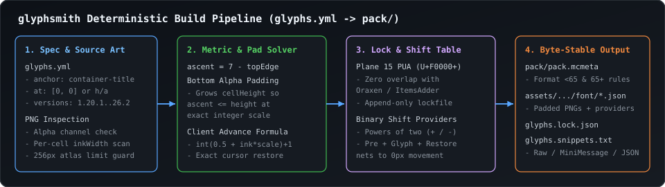

# glyphsmith

[](https://github.com/SalyyS1/glyphsmith/actions/workflows/build.yml)
[](https://github.com/SalyyS1/glyphsmith/releases)
[](https://salyys1.github.io/glyphsmith/)
[](LICENSE)

glyphsmith turns a PNG and a pixel coordinate into a Minecraft font glyph that lands exactly there, and audits single or stacked resource packs against the vanilla font loader's invariants with OASIS SARIF v2.1.0 output. You say where the artwork goes; it works out the provider height, the ascent, how much transparent padding the texture needs for that ascent to be legal, the advance the client derives from your pixels, and the negative-space characters that move the cursor into place. Then it writes a deterministic, lock-pinned resource pack.

Try the zero-upload client-side [**Browser Font Pack Auditor & Glyph Metric Solver**](https://salyys1.github.io/glyphsmith/) directly in your browser.

```text
$ glyphsmith build glyphs.yml
== myserver:ui -> pack
   ui.panel  U+F0016  176x64  h 64  a 13  adv 177
   hud.coin  U+F0017  9x9     h 9   a 8   adv 9
   shift glyphs cover 1..1024px in both directions

   ui.panel: \uDB80\uDC07\uDB80\uDC16\uDB80\uDC0F\uDB80\uDC0B\uDB80\uDC07\uDB80\uDC01
   hud.coin: \uDB80\uDC17

Wrote 2 glyphs to pack
Codepoints pinned in glyphs.lock.json
Strings in glyphs.snippets.txt
```

The panel in that run is aimed at the top-left corner of a container window. What came out is `ascent: 13`, `height: 64`, a leading 8px shift and a 169px shift afterwards to put the cursor back where the title expects it: six numbers that are usually found by editing a JSON file, restarting the client, squinting, and repeating.

## Why this exists

Two rules in the client collide, and everything difficult about image glyphs comes out of that collision.

The first is a hard error: `ascent` may not be greater than `height`, and a font file that breaks it is rejected whole, taking every unrelated glyph in it down with it. The second is that `height` is not the height of your image: it is a render height, and the client divides it by the cell height to get the scale factor. Raising `height` to buy headroom for a larger `ascent` magnifies the texture.

The way out is to pad the source with transparent rows at the bottom, which grows the cell so `height` can grow with it at the same ratio. That is what ItemsAdder's documentation describes when it advises adding blank pixels on the bottom of an image to raise height without scaling. It is not a calculation you have to perform by hand, and glyphsmith solves it automatically.

The advance is the other half. The client measures it from your artwork (the rightmost column with any ink, scaled, rounded, plus one unconditional pixel), so a glyph's width is never what you declared and horizontal layout drifts by a pixel or two per glyph. glyphsmith reads the same pixels and emits the exact correction.

<p align="center">
  
</p>

## Getting started

You need Java 21 or newer. Download `glyphsmith-0.3.0.jar` from [**Releases**](https://github.com/SalyyS1/glyphsmith/releases), then:

```sh
glyphsmith init                             # writes glyphs.yml and two PNGs to start from
glyphsmith build glyphs.yml --zip pack.zip  # writes pack/, pack.zip, glyphs.lock.json and glyphs.snippets.txt
glyphsmith audit pack.zip --strict          # audits every font provider, overlay, and PNG cell against client rules
```

`init` draws its own artwork, so the example builds offline on a clean checkout.

## Auditing resource packs and multi-pack stacks (`glyphsmith audit`)

Server resource packs merged from multiple plugins or stacked in load order often break silently on the client. `glyphsmith audit` inspects one or more resource pack directories or `.zip` archives (whether generated by glyphsmith, Oraxen, Nexo, ItemsAdder, BetterHud, or hand-written), resolves `pack.mcmeta` `overlays.entries` with base texture fallback, and validates every font definition:

- **`BITMAP_ASCENT_EXCEEDS_HEIGHT` (error):** `ascent > height` in a `bitmap` provider, which causes the client to discard the entire font file.
- **`BITMAP_INVALID_HEIGHT` (error):** Non-positive `height` (`<= 0`) in a `bitmap` provider.
- **`BITMAP_MISSING_TEXTURE` (error):** Missing or unreadable PNG texture referenced by `"file"` (checked across overlay and base assets).
- **`BITMAP_IRREGULAR_GRID` (error):** Empty `chars` array or rows of unequal codepoint count.
- **`BITMAP_CELL_EXCEEDS_ATLAS` (error):** Individual glyph cell larger than `256x256` source pixels (`FontTexture` atlas limit).
- **`BITMAP_GRID_MISMATCH` (warning):** PNG dimensions not evenly divisible by grid column/row counts, causing right/bottom pixel truncation.
- **`SPACE_INVALID_ADVANCE` (error):** Quoted string or out-of-range advance value outside `SpaceProvider` Codec bounds `[-8192, 8192]`.
- **`REFERENCE_CYCLE` / `REFERENCE_MISSING_ID` (error):** Circular `"type": "reference"` chains (`A -> B -> A`) or malformed font identifiers.
- **`REFERENCE_MISSING_TARGET` (warning):** Custom `"reference"` target font missing across the pack or stack.
- **`OVERLAY_INVALID_DIRECTORY` (error):** Invalid or empty `overlays.entries[].directory` declared in `pack.mcmeta`.
- **`CODEPOINT_SHADOWED` (warning):** Later provider in the same font ID overwriting an earlier provider's codepoint.
- **`CROSS_PACK_CODEPOINT_COLLISION` (warning):** Higher-priority pack in a multi-pack stack silently overwriting a codepoint defined by a lower pack in the same font ID.
- **`CODEPOINT_BMP_PUA_HAZARD` (warning):** Allocation inside BMP Private Use Area (`U+E000..U+F8FF`) where custom-item plugins collide.

```sh
glyphsmith audit server-pack.zip --strict
glyphsmith audit base-ui.zip items-pack.zip hud-pack.zip --strict --json > stack-audit.json
glyphsmith audit server-pack.zip --sarif glyphsmith.sarif
```

## CI lockfile verification, SARIF v2.1.0, and JSON output

Commit `glyphs.lock.json` alongside `glyphs.yml`. In pull request CI, pass `--locked` to guarantee that no glyph allocates unreviewed codepoints and no source PNG or solved metric drifted from the committed lockfile:

```sh
glyphsmith build glyphs.yml --locked --strict --json
glyphsmith plan art/hud.coin.png --at 0,-6 --json
```

### GitHub Action & GitHub Code Scanning (SARIF)

```yaml
- uses: SalyyS1/glyphsmith@v0.3.0
  with:
    args: build glyphs.yml --locked --strict
```

Audit stacked server packs and upload OASIS SARIF v2.1.0 results to GitHub Code Scanning:

```yaml
- uses: SalyyS1/glyphsmith@v0.3.0
  id: font-audit
  with:
    args: audit build/base-pack.zip build/hud-pack.zip
    sarif: build/glyphsmith.sarif

- uses: github/codeql-action/upload-sarif@v3
  if: always()
  with:
    sarif_file: ${{ steps.font-audit.outputs.sarif-file }}
```

## The spec file

```yaml
namespace: myserver              # where the textures live
font: myserver:ui                # the font id the glyphs go on
versions: 1.20.1..26.3           # what pack.mcmeta has to satisfy
codepoints: U+F0000              # where allocation starts
shifts: 1024                     # largest single shift step

glyphs:
  ui.panel:
    image: art/ui.panel.png
    anchor: container-title       # coordinates are the window's own top-left corner
    at: [0, 0]

  hud.coin:
    image: art/hud.coin.png
    height: 9                     # or state the two numbers yourself
    ascent: 8
```

Give a glyph `at` and an `anchor` and the numbers are derived; give it `height` and `ascent` and they are passed through and checked. Mixing the two is an error, and unknown keys (`ascnet: 8`) are refused by name. See `docs/spec.md` for the full reference.

## Working out one glyph (`glyphsmith plan`)

`plan` runs the solver without writing files:

```text
$ glyphsmith plan art/hud.coin.png --at 0,-6
art/hud.coin.png  9x9, alpha yes
   ink        8px wide, 8px tall
   placement  0,-6 relative to wherever the text is drawn -> (0, -6) from the text origin
   height     13
   ascent     13   (top edge lands -6px below the text origin)
   padding    4px below, 0px right, added so the cell divides evenly and the ascent is legal
   cells      1 of 9x13px, scale 1.0
   advance    9 = 9px
   restore    -9px puts the cursor back where it started
```

Query commands for existing lockfiles:

```sh
glyphsmith string ui.panel --as minimessage    # print the string without rebuilding
glyphsmith shift --as escape -- -13            # print the characters that move 13px left
```

## What lands on disk

<p align="center">
  
</p>

```text
pack/
  pack.mcmeta
  assets/myserver/font/ui.json                 # one space provider, then one bitmap per glyph
  assets/myserver/textures/font/ui.panel.png   # your artwork, padded as needed
glyphs.lock.json                               # id -> codepoint, sha256, and solved metrics
glyphs.snippets.txt                            # every glyph as raw, escape, MiniMessage and JSON
```

Output is byte-stable for identical inputs: zip entries carry a fixed timestamp, files are written in sorted order, and codepoint allocation is append-only so existing signs, item lore, and database rows never change meaning.

## Client font formulas

| Property | Vanilla client formula |
|---|---|
| cell size | `imageWidth / columns` by `imageHeight / rows`, integer division (uneven division truncates remainder pixels) |
| scale | `height / cellHeight`, so `height` is a render height and doubles as the scale factor |
| top edge | `7 - ascent`, in pixels from the text origin (`ascent: 7` aligns with the baseline) |
| advance | `(int)(0.5 + inkWidth * scale) + 1`, where `inkWidth` is one past the rightmost column with non-zero alpha |
| hard limit | `ascent > height` rejects the entire font file |
| hard limit | cells exceeding `256x256` source pixels fail atlas stitching and render as missing-glyph boxes |

## Codepoints and `pack.mcmeta`

Allocation defaults to Plane 15 (`U+F0000`, Supplementary Private Use Area A, 65,534 codepoints) rather than BMP Private Use Area (`U+E000..U+F8FF`), avoiding collisions with Oraxen, Nexo, and ItemsAdder default ranges.

For `versions: 1.20.1..26.3`, glyphsmith emits dual-era `pack.mcmeta` fields (`pack_format`, `supported_formats`, `min_format`, and `max_format`) satisfying both pre-1.21.9 (format <= 64) and modern minor-format rules (format >= 65, up to `26.3` format `97`).

## Building from source

```sh
./gradlew build --no-daemon    # runs JUnit 5 suite and builds build/libs/glyphsmith-0.3.0.jar
```

## Related Minecraft Engineering Tools by Salyvn

- [**packmerge**](https://github.com/SalyyS1/packmerge): Deterministic multi-plugin Minecraft resource pack compiler for fonts, 1.21.4+ item models, sounds, lang files, and atlases.
- [**packmigrate**](https://github.com/SalyyS1/packmigrate): Automated resource pack migrator across Minecraft format versions and 1.21.4+ item definitions.
- [**shadersmith**](https://github.com/SalyyS1/shadersmith): Vanilla core-shader and post-effect pipeline validator and builder for Minecraft resource packs.
- [**foliascan**](https://github.com/SalyyS1/foliascan): Static bytecode analyzer with SARIF call-graph taint flows for Paper and Folia server plugins.
- [**pluginscope**](https://github.com/SalyyS1/pluginscope): Plugin JAR dependency, shadow-relocation, and Paper/Spigot compatibility auditor.
- [**serverdoctor**](https://github.com/SalyyS1/serverdoctor): Live config, JVM flag, and crash/timings diagnostic CLI for Minecraft servers.
- [**mcstage**](https://github.com/SalyyS1/mcstage): Reproducible staging environment builder for Paper, Folia, and Velocity server networks.
- [**minecraftkit**](https://github.com/SalyyS1/minecraftkit): MCP server and engineering knowledge kit for Minecraft plugin and pack development.

## Credits and Licence

See `NOTICE` for upstream references ([unnamed/creative](https://github.com/unnamed/creative), [Brikster/glyphs](https://github.com/Brikster/glyphs), [AmberWat/NegativeSpaceFont](https://github.com/AmberWat/NegativeSpaceFont)). Independent project; not affiliated with Mojang or Microsoft. Licensed under [Apache-2.0](LICENSE).
